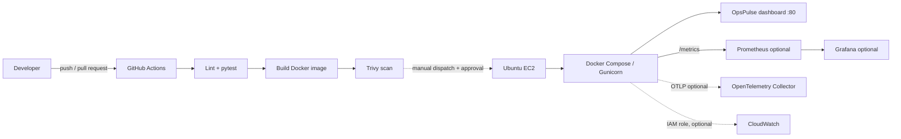

# OpsPulse — Cloud & DevOps Operations Platform

OpsPulse adalah proyek portofolio personal untuk memperlihatkan alur delivery aplikasi web sederhana: perubahan kode, pemeriksaan otomatis, image container, deployment EC2 yang dapat dipicu manual, dan pemantauan metrik runtime. Proyek ini bukan klaim pengalaman produksi atau integrasi cloud yang sudah aktif.

## 1. Masalah dan solusi

Operasi aplikasi kecil sering tersebar antara pemeriksaan manual, log, dan konfigurasi yang sulit diulang. OpsPulse menyediakan dashboard untuk status proses dan metrik yang benar-benar dikumpulkan aplikasi, API health, endpoint Prometheus, serta contoh pipeline dan konfigurasi operasional yang dipisahkan dari MVP.

## 2. Arsitektur



CI dan deployment ke EC2 berbeda: pull request dan push ke `main` hanya menjalankan validasi; deployment hanya dapat diminta lewat `workflow_dispatch`, memerlukan input eksplisit, environment `production` yang sebaiknya memiliki reviewer, serta secret yang telah disiapkan. Terraform, Kubernetes, ECS, EKS, Argo CD, CloudWatch, Grafana, dan Azure DevOps tidak menjadi prasyarat aplikasi.

## 3. Teknologi dan struktur

- Aplikasi: Python 3.12, Flask, Gunicorn, psutil, HTML/CSS/JavaScript.
- Metrik: Prometheus client; OpsPulse mengukur CPU dan RSS proses aplikasi, filesystem yang terlihat dari proses, uptime proses, request count dan latency.
- Delivery utama: GitHub Actions; container non-root; Docker Compose.
- Contoh terpisah: Terraform AWS, Kubernetes, ECS, Argo CD, Azure Pipelines, Grafana, CloudWatch, OpenTelemetry.

```text
app/                         Flask app, API, dashboard, metrik, telemetry
tests/                       pytest
.github/workflows/ci-cd.yml   CI dan deployment EC2 manual/protected
monitoring/                   Prometheus, Grafana, OpenTelemetry Collector
infrastructure/terraform/     EC2 dan security group (tidak otomatis dijalankan)
kubernetes/                   Deployment, Service, ConfigMap
deployment/ecs/               ECS task definition dan service template
argocd/                       Argo CD Application template
azure-pipelines/              Pipeline alternatif
scripts/                      Health check dan operasi Linux
docs/                         CV mapping dan panduan wawancara
```

## 4. Menjalankan lokal

Siapkan Python 3.12, kemudian dari root proyek:

```bash
python -m venv .venv
# Linux/macOS:
source .venv/bin/activate
# Windows PowerShell:
# .venv\Scripts\Activate.ps1
python -m pip install -r requirements-dev.txt
ruff check app tests
pytest -q
gunicorn --bind 127.0.0.1:8000 --workers 2 'app:create_app()'
```

Buka `http://127.0.0.1:8000`. Endpoint API:

| Path | Kegunaan |
|---|---|
| `/` | Dashboard responsif |
| `/health` | Kesehatan proses aplikasi; tidak mengecek dependency eksternal |
| `/api/metrics` | JSON metrik proses dan status integrasi |
| `/api/info` | Informasi runtime non-sensitif dan release identifier opsional |
| `/metrics` | Format Prometheus |

Metrik yang tidak dapat dibaca dilaporkan `unavailable`/`null`, bukan angka buatan. CPU dan memory adalah milik proses Flask/Gunicorn; filesystem adalah filesystem yang terlihat di dalam container. Ini bukan metrik host EC2. Container health tidak dibaca dari Docker socket (socket tidak dipasang ke aplikasi), dan dashboard tidak mengambil log/event feed. CloudWatch, bila dikonfigurasi, dilabeli sebagai metrik instance EC2 terpisah.

## 5. Pengujian

```bash
ruff check app tests
pytest -q
docker compose config
docker build -t opspulse:local .
```

Workflow GitHub menjalankan lint, pytest, build image, serta Trivy untuk kerentanan HIGH/CRITICAL pada OS dan library. Hasil validasi lokal dan batasan tooling dicatat pada laporan implementasi. Temuan image tidak diabaikan; perbarui dependency/base image atau mitigasi secara terdokumentasi sebelum mengubah threshold.

## 6. Docker dan Compose

```bash
docker compose up -d --build
docker compose ps
curl http://127.0.0.1:8080/health
docker compose logs --tail=100 app
docker compose down
```

Default port host lokal adalah `127.0.0.1:8080`; port Gunicorn `8000` tidak dipublikasikan langsung. Compose menerapkan read-only root filesystem, capability drop, `no-new-privileges`, non-root image, health check, restart policy, dan rotasi log. Untuk demo EC2 port 80, gunakan `OPSPULSE_BIND_ADDRESS=0.0.0.0 OPSPULSE_HOST_PORT=80` hanya pada host yang security group-nya telah ditinjau.

Opsional Prometheus/Grafana:

```bash
cp .env.example .env
# Ganti GRAFANA_ADMIN_PASSWORD dengan nilai acak yang kuat.
docker compose --profile monitoring up -d --build
```

Grafana dan Prometheus secara default hanya bind ke loopback host (port 3000/9090); akses melalui SSH tunnel atau host lokal. Prometheus target dapat diperiksa di `http://127.0.0.1:9090/targets`. Konfigurasi scrape 15 detik dan dashboard Grafana hanya mengacu metrik yang disediakan aplikasi. Profil ini menambah container, storage, dan penggunaan RAM/CPU; jangan aktifkan pada instance kecil tanpa memeriksa kapasitas dan biaya.

## 7. GitHub Actions

1. Push repository ke GitHub dengan branch `main`.
2. Pastikan Actions diaktifkan dan tinjau hasil job `validate`.
3. Untuk deployment, siapkan Ubuntu EC2 terlebih dahulu (bagian berikut).
4. Buat GitHub Environment bernama `production`; aktifkan required reviewers dan branch restriction `main`.
5. Tambahkan secrets di environment (bukan di file):
   - `EC2_HOST`: IP publik EC2 atau hostname yang telah diverifikasi.
   - `EC2_USER`: akun deployment non-root yang dapat menjalankan Docker Compose dan menulis `/opt/opspulse`.
   - `EC2_SSH_PRIVATE_KEY`: private key khusus deployment, akses minimum, dapat dirotasi.
   - `EC2_KNOWN_HOSTS`: baris `known_hosts` yang host key-nya diperoleh dan diverifikasi lewat kanal independen.
6. Jalankan workflow manual pada `main`, pilih `deploy_to_ec2=true`, lalu tunggu approval environment.

Jangan menggunakan `ssh-keyscan` sebagai bukti kepercayaan. Ambil fingerprint host melalui kanal administrasi EC2/SSM atau sesi terverifikasi lain dan cocokkan sebelum menyimpan nilai `known_hosts`. Pipeline membangun image pada job CI; deployment mengirim bundle kode ke host dan membangun image di EC2. Tidak ada image yang dipublikasikan ke registry.

## 8. Persiapan dan deployment EC2

Persyaratan demo: Ubuntu Server 22.04/24.04, IPv4 publik, akses Docker Engine + Docker Compose plugin, dan kapasitas yang cukup untuk build image (misalnya minimal 2 vCPU/2 GiB untuk kenyamanan; ukuran dan biaya bergantung region dan workload). EC2 instance type/storage/IPv4 dapat menimbulkan biaya; periksa kalkulator AWS dan hapus resource yang memang sudah tidak dibutuhkan.

Security group:

- TCP 22 hanya dari IP administrator `/32` atau tutup dan gunakan SSM.
- TCP 80 publik untuk demo tanpa domain.
- Jangan buka TCP 8000, 3000, atau 9090 ke internet.
- Host firewall UFW dan AWS security group adalah lapisan berbeda; pastikan keduanya konsisten dan tidak mengunci akses SSH.

Pasang Docker Engine/Compose mengikuti dokumentasi resmi Ubuntu/Docker. Buat akun deployment non-root, tambahkan ke grup `docker` (akses grup Docker setara akses root), siapkan folder deployment, lalu verifikasi izin host key dari sesi administrator:

```bash
sudo install -d -o "$USER" -g docker /opt/opspulse
docker --version
docker compose version
```

`$USER` di atas harus akun deployment yang dipakai GitHub Actions. Untuk deployment manual tanpa Actions, salin source yang telah direview ke host lalu:

```bash
cd /opt/opspulse
OPSPULSE_BIND_ADDRESS=0.0.0.0 \
OPSPULSE_HOST_PORT=80 \
OPSPULSE_RELEASE=<commit-yang-disetujui> \
docker compose up -d --build
docker compose ps
curl --fail http://127.0.0.1/health
```

Akses `http://EC2_PUBLIC_IP/`. IP tidak ditulis dalam kode aplikasi. Logs: `docker compose logs --tail=100 app`; status: `docker compose ps`; cek port: `sudo ss -lntp`; cek filesystem: `df -h`; cek proses container: `docker stats`. Jangan menyalakan monitoring ports publik. Troubleshooting detail di `scripts/ops.sh` dan `docs/INTERVIEW_GUIDE.md`.

Rollback manual: pertahankan tag image rilis yang diketahui baik sebelum mengganti release. Jika tag lama tersedia:

```bash
docker tag opspulse:<tag-lama> opspulse:local
cd /opt/opspulse
docker compose up -d --no-build
curl --fail http://127.0.0.1/health
```

Workflow melakukan pemeriksaan HTTP setelah deployment dan menandai kegagalan bila tidak sehat. Sebelum aktivasi pada host nyata, tinjau mekanisme rollback, izin folder, dan image build terlebih dahulu. Untuk deployment pertama tidak ada release lama untuk dipulihkan.

## 9. Terraform (opsional dan menimbulkan biaya)

`infrastructure/terraform` membuat instance EC2 baru serta security group. Ini bukan konfigurasi reuse instance. Isi `terraform.tfvars` lokal (jangan commit) dengan AMI Ubuntu, subnet, key pair yang sudah ada, region, dan SSH CIDR milik Anda. Lalu `terraform init`, `terraform fmt -check`, `terraform validate`, `terraform plan`; tinjau seluruh plan. `terraform apply` dan `terraform destroy` tidak dijalankan oleh proyek dan memerlukan persetujuan pemilik akun. State remote/locking, backup state, serta proteksi output harus ditentukan sebelum pemakaian bersama. Jangan commit state atau plan.

Bila sudah memiliki EC2, jangan apply konfigurasi ini: gunakan petunjuk deploy manual/Actions dan security group yang telah ada.

## 10. CloudWatch, OpenTelemetry

**CloudWatch (opsional):** install `requirements-cloudwatch.txt`, set `AWS_CLOUDWATCH_INSTANCE_ID` dan `AWS_REGION`, berikan instance profile dengan izin minimum untuk membaca metrik EC2, misalnya `cloudwatch:GetMetricStatistics` (API ini biasanya memerlukan resource `*`; tinjau dukungan condition AWS). Gunakan IAM role/credential chain, bukan access key di source/container. Endpoint menampilkan metrik CPU EC2 hanya bila datapoint berhasil dibaca; bila paket, izin, region, atau data tidak tersedia, statusnya `unavailable`. Uji dengan membandingkan API `/api/metrics` terhadap CloudWatch Console. Integrasi belum dianggap aktif hanya karena ID instance diatur.

**OpenTelemetry (opsional):** install `requirements-otel.txt`, set `OTEL_EXPORTER_OTLP_ENDPOINT` ke endpoint HTTP collector tepercaya, misalnya `http://localhost:4318` dalam jaringan yang benar. Aplikasi akan membuat span Flask dan mengekspor OTLP/HTTP. `monitoring/opentelemetry/collector.yaml` adalah contoh collector dengan debug exporter; file itu bukan backend tracing tahan lama. Verifikasi dengan membuat request dan memeriksa span pada collector. Status endpoint hanya menyatakan konfigurasi, bukan keberhasilan ekspor. Instrumentasi menghasilkan trace; Prometheus mengumpulkan time series; Grafana menampilkan time series; log dipakai untuk investigasi event.

Collector contoh dapat dijalankan lokal (Linux/macOS) dengan `docker run --rm --name opspulse-otel -p 127.0.0.1:4318:4318 -v "$PWD/monitoring/opentelemetry/collector.yaml:/etc/otelcol-contrib/config.yaml:ro" otel/opentelemetry-collector-contrib:0.128.0 --config=/etc/otelcol-contrib/config.yaml`. Aplikasi yang berjalan di host mengarah ke `http://127.0.0.1:4318`; aplikasi dalam container memerlukan alamat collector yang dapat dicapai dari jaringan tersebut. Periksa `docker logs opspulse-otel` untuk span debug. Jangan membuka port OTLP ke internet.

## 11. Kubernetes, EKS, ECS, dan Argo CD

Manifest Kubernetes berada di `kubernetes/deployment.yaml`. Ganti image placeholder dengan image yang telah dibangun/dipublikasikan, siapkan namespace, registry access dan Secret bila dibutuhkan; manifest menyediakan readiness/liveness, resource request/limit, rolling update, non-root, dan Service internal `ClusterIP`. Tidak disertakan Ingress/load balancer. Validasi dan deployment harus dilakukan pada cluster milik operator:

```bash
kubectl apply --dry-run=client -f kubernetes/deployment.yaml
kubectl rollout status deployment/opspulse
kubectl rollout undo deployment/opspulse
```

EKS memerlukan control plane, worker capacity, VPC/subnet, IAM/OIDC/workload permissions, registry, dan jalur service exposure. Biaya cluster, compute, storage, NAT, load balancer, logs, dan data transfer biasanya jauh melebihi demo satu EC2; jangan membuat cluster untuk MVP.

Contoh ECS Fargate terpisah: `deployment/ecs/task-definition.json` dan `service.json`. Ganti seluruh placeholder account/region/ARN/subnet/security group; siapkan ECR image, task execution role, task role, log group, security group, dan target akses yang sesuai. Jangan menjalankan `aws ecs create-service` sebelum review biaya, networking, dan IAM.

Argo CD: `argocd/opspulse-application.yaml` menunjuk repo dan path `kubernetes`. Ganti repository/namespace, pasang Argo CD dan cluster sendiri. Sync manual adalah pilihan default operasional; konfigurasi auto-sync pada contoh tidak menghapus resource (`prune:false`) dan tidak memperbaiki drift otomatis (`selfHeal:false`). Review perubahan Git, periksa Sync/Health, dan rollback dengan revert commit lalu sync kembali. Belum ada koneksi cluster.

## 12. Azure DevOps alternatif

`azure-pipelines/azure-pipelines.yml` menjalankan dependency setup, Ruff, pytest, Docker build, dan Trivy. Ini contoh independen, tidak pernah dijalankan di Azure DevOps pada workspace ini. Publikasi image/deployment belum dikonfigurasi. Bila menambahkan, gunakan service connection dan variable group rahasia yang disetujui; jangan menaruh token di YAML.

## 13. Keamanan dan jaringan

- API tidak mengembalikan environment, secret, atau traceback; `release` dibatasi karakter dan panjang.
- Container non-root, root filesystem read-only, capability drop, dan tidak menerima secret build arg.
- GitHub deploy memakai host key yang disimpan sebagai secret tepercaya, bukan trust-on-first-use.
- SSH dibatasi IP, HTTP publik hanya untuk dashboard, port aplikasi internal tidak dipublikasikan.
- Terraform memakai IMDSv2, encrypted gp3 volume, dan security group minimum.
- Dashboard hanya menampilkan metrik proses dan tidak mengklaim metrik EC2 host.
- Tinjau dependency/base image dan hasil Trivy; laporan keamanan melalui `SECURITY.md`.

## 14. Biaya dan keterbatasan

EC2, public IPv4, EBS, data transfer, CloudWatch, ECR, ECS, EKS, NAT Gateway, dan load balancer dapat berbiaya. Prometheus/Grafana/Collector memerlukan kapasitas CPU/RAM/disk tambahan dan tidak punya retention/backup produksi. Tidak ada domain, DNS zone, TLS certificate, load balancer, secret manager, atau backend observability yang dibuat oleh repository. Cloud/API testing, Terraform plan, cluster validation, dan deployment harus dilakukan setelah konfigurasi akun tersedia.

## 15. Hasil validasi lokal

Validasi dilakukan pada 20 Oktober 2026. Build/test lokal memakai Docker dengan Python 3.12 agar sesuai dengan image aplikasi (`python` tidak tersedia langsung di PATH host; launcher `py` tersedia).

| Pemeriksaan | Hasil aktual |
|---|---|
| Ruff (`ruff check app tests`) | Lulus |
| pytest | Lulus, 9 tes |
| Docker build | Lulus, image multi-stage Alpine |
| Docker runtime | Lulus; health check container healthy, `/health`, `/api/metrics`, dan `/metrics` merespons |
| Docker Compose config | Lulus untuk core dan profil monitoring |
| Trivy image scan | Lulus, tidak ada kerentanan HIGH/CRITICAL pada image final |
| Prometheus config | `promtool check config` lulus; scrape target runtime belum dijalankan |
| GitHub Actions actionlint | Lulus sintaks dan shellcheck workflow |
| Bash `bash -n` | Lulus untuk semua script |
| Terraform | `fmt -check`, `init -backend=false`, dan `validate` lulus; `plan/apply` tidak dijalankan |
| Kubernetes manifest | kubeconform lulus, 3 resource valid; `kubectl` dry-run tidak dapat dipakai karena context lokal mengarah ke endpoint Jenkins yang meminta autentikasi |
| JSON templates | ECS task/service dan Grafana dashboard berhasil diparse |
| YAML files | 9 file berhasil diparse |
| Prometheus/Grafana runtime, CloudWatch, OTLP, AWS deploy, GitHub Actions remote | Tidak dijalankan; memerlukan service/configuration atau akun eksternal |
| Pull request | Tidak dibuat: folder workspace ini tidak memiliki `.git` atau remote GitHub yang dapat ditulis |

Scan awal pada image Debian `slim` menemukan 44 HIGH dan 2 CRITICAL yang belum diperbaiki di paket OS. Base image diganti dengan multi-stage Alpine dan scan final dijalankan ulang tanpa mengabaikan temuan; hasil akhir 0 HIGH/CRITICAL. Scan perlu diulang saat CI berjalan karena database dan image base terus berubah.

Validasi sintaks bukan bukti aplikasi telah dideploy ke cloud atau integrasi telah tersambung. Keberadaan konfigurasi tidak berarti layanan telah dideploy.

## 16. CV-to-project mapping dan wawancara

- [Pemetaan CV ke proyek](docs/CV_MAPPING.md)
- [Panduan wawancara](docs/INTERVIEW_GUIDE.md)

Semua rincian pendidikan, jabatan, dan periode kerja dalam CV tetap milik pemilik CV. Implementasi portofolio ini tidak menambahkan klaim pengalaman, pencapaian kerja, tanggung jawab produksi, atau sertifikasi.
