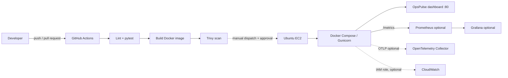

# OpsPulse — Cloud & DevOps Operations Platform

OpsPulse adalah proyek portofolio personal untuk memperlihatkan alur delivery aplikasi web sederhana: perubahan kode, pemeriksaan otomatis, image container, deployment EC2 yang dapat dipicu manual, dan pemantauan metrik runtime. Proyek ini bukan klaim pengalaman produksi atau integrasi cloud yang sudah aktif.

## 1. Masalah dan solusi

Operasi aplikasi kecil sering tersebar antara pemeriksaan manual, log, dan konfigurasi yang sulit diulang. OpsPulse menyediakan dashboard untuk status proses dan metrik yang benar-benar dikumpulkan aplikasi, API health, endpoint Prometheus, serta contoh pipeline dan konfigurasi operasional yang dipisahkan dari MVP.

## 2. Arsitektur



CI dan deployment ke EC2 berbeda: pull request dan push ke `main` hanya menjalankan validasi; deployment hanya dapat diminta lewat `workflow_dispatch`, memerlukan input eksplisit, environment `production` yang sebaiknya memiliki reviewer, serta secret yang telah disiapkan. Terraform, Kubernetes, ECS, EKS, Argo CD, CloudWatch, Grafana, dan Azure DevOps tidak menjadi prasyarat aplikasi.

## 3. Teknologi dan struktur

- Aplikasi: Python 3.12, Flask, Gunicorn, psutil, HTML/CSS/JavaScript.
- Metrik: Prometheus client; OpsPulse mengukur CPU dan RSS proses aplikasi, filesystem yang terlihat dari proses, uptime proses, request count dan latency.
- Delivery utama: GitHub Actions; container non-root; Docker Compose.
- Contoh terpisah: Terraform AWS, Kubernetes, ECS, Argo CD, Azure Pipelines, Grafana, CloudWatch, OpenTelemetry.

```text
app/                         Flask app, API, dashboard, metrik, telemetry
tests/                       pytest
.github/workflows/ci-cd.yml   CI dan deployment EC2 manual/protected
monitoring/                   Prometheus, Grafana, OpenTelemetry Collector
infrastructure/terraform/     EC2 dan security group (tidak otomatis dijalankan)
kubernetes/                   Deployment, Service, ConfigMap
deployment/ecs/               ECS task definition dan service template
argocd/                       Argo CD Application template
azure-pipelines/              Pipeline alternatif
scripts/                      Health check dan operasi Linux
docs/                         CV mapping dan panduan wawancara
```

## 4. Menjalankan lokal

Siapkan Python 3.12, kemudian dari root proyek:

```bash
python -m venv .venv
# Linux/macOS:
source .venv/bin/activate
# Windows PowerShell:
# .venv\Scripts\Activate.ps1
python -m pip install -r requirements-dev.txt
ruff check app tests
pytest -q
gunicorn --bind 127.0.0.1:8000 --workers 2 'app:create_app()'
```

Buka `http://127.0.0.1:8000`. Endpoint API:

| Path | Kegunaan |
|---|---|
| `/` | Dashboard responsif |
| `/health` | Kesehatan proses aplikasi; tidak mengecek dependency eksternal |
| `/api/metrics` | JSON metrik proses dan status integrasi |
| `/api/info` | Informasi runtime non-sensitif dan release identifier opsional |
| `/metrics` | Format Prometheus |

Metrik yang tidak dapat dibaca dilaporkan `unavailable`/`null`, bukan angka buatan. CPU dan memory adalah milik proses Flask/Gunicorn; filesystem adalah filesystem yang terlihat di dalam container. Ini bukan metrik host EC2. Container health tidak dibaca dari Docker socket (socket tidak dipasang ke aplikasi), dan dashboard tidak mengambil log/event feed. CloudWatch, bila dikonfigurasi, dilabeli sebagai metrik instance EC2 terpisah.

## 5. Pengujian

```bash
ruff check app tests
pytest -q
docker compose config
docker build -t opspulse:local .
```

Workflow GitHub menjalankan lint, pytest, build image, dan Trivy untuk kerentanan HIGH/CRITICAL pada OS dan library. Hanya image yang lolos validasi dan scan yang dipublikasikan dengan tag commit SHA ke GHCR. Temuan image tidak diabaikan; perbarui dependency/base image atau mitigasi secara terdokumentasi sebelum mengubah threshold.

## 6. Docker dan Compose

```bash
docker compose up -d --build
docker compose ps
curl http://127.0.0.1:8080/health
docker compose logs --tail=100 app
docker compose down
```

Default port host lokal adalah `127.0.0.1:8080`; port Gunicorn `8000` tidak dipublikasikan langsung. Compose menerapkan read-only root filesystem, capability drop, `no-new-privileges`, non-root image, health check, restart policy, dan rotasi log. Untuk demo EC2 port 80, gunakan `OPSPULSE_BIND_ADDRESS=0.0.0.0 OPSPULSE_HOST_PORT=80` hanya pada host yang security group-nya telah ditinjau.

Opsional Prometheus/Grafana:

```bash
cp .env.example .env
# Ganti GRAFANA_ADMIN_PASSWORD dengan nilai acak yang kuat.
docker compose --profile monitoring up -d --build
```

Grafana dan Prometheus secara default hanya bind ke loopback host (port 3000/9090); akses melalui tunnel aman atau host lokal. Prometheus target dapat diperiksa di `http://127.0.0.1:9090/targets`. Konfigurasi scrape 15 detik dan dashboard Grafana hanya mengacu metrik yang disediakan aplikasi. Profil ini menambah container, storage, dan penggunaan RAM/CPU; jangan aktifkan pada instance kecil tanpa memeriksa kapasitas dan biaya.

## 7. GitHub Actions dan deployment EC2

CI pada pull request/push ke `main` menjalankan Terraform fmt/init/validate, Ruff, pytest, build container, dan Trivy. Hanya hasil scan yang lulus pada `main`/manual dispatch yang dipublikasikan ke `ghcr.io/alveoniro98/opspulse` menggunakan tag commit SHA. Job deployment tidak berjalan otomatis setelah push.

Pada audit 20 Oktober 2026, workflow di `main` masih menggunakan SSH key dan tidak memiliki secret yang dibutuhkan. Perubahan pada branch ini menggantinya dengan OIDC dan Systems Manager; perubahan tersebut belum merge atau dideploy. GitHub Environment `production` kini dibatasi ke branch `main`, memerlukan reviewer `alveoniro98`, dan tidak dapat di-bypass administrator. AWS OIDC provider dan role SSM terbatas sudah dibuat; environment variables `AWS_ROLE_ARN` dan `AWS_REGION` telah diatur tanpa access key. `EC2_INSTANCE_ID`, `EC2_PUBLIC_IP`, dan package GHCR publik belum tersedia. Jangan memicu workflow SSH lama.

Sebelum deployment pertama:

1. Verifikasi OIDC provider `token.actions.githubusercontent.com` (audience `sts.amazonaws.com`) dan role `opspulse-github-actions-deploy`; jangan membuat duplikat. Trust dibatasi ke `repo:alveoniro98/monitoring_project:environment:production`.
2. Role menggunakan izin SSM minimum untuk mengirim command hanya ke EC2 bertag `Project=opspulse`, serta membaca status invocation. Template JSON memakai `ACCOUNT_ID` sebagai contoh; jangan menambahkan izin `ec2:*`, `iam:*`, atau akses AWS luas.
3. Environment `production`, reviewer, aturan branch `main`, dan variables `AWS_ROLE_ARN`/`AWS_REGION` sudah disiapkan. Setelah EC2 dibuat dan plan di-apply, isi variables `EC2_INSTANCE_ID` dan `EC2_PUBLIC_IP` dari output Terraform. Tidak diperlukan AWS access key atau GitHub secret.
4. Atur package `ghcr.io/alveoniro98/opspulse` menjadi **public** setelah image pertama dipublikasikan agar EC2 dapat pull tanpa credential registry. Repository GitHub ini public, tetapi visibility package perlu diperiksa tersendiri.
5. Pastikan instance berada di Systems Manager **Managed nodes** (agent online). Kemudian jalankan workflow `OpsPulse CI and approved EC2 deployment` pada `main`, pilih `deploy_to_ec2=true`, dan setujui Environment deployment.

Workflow menggunakan OIDC untuk credential AWS sementara; tidak ada AWS access key, SSH private key, atau TCP 22 yang diperlukan. SSM menjalankan script deployment pada instance, menarik image GHCR yang telah lulus CI/security scan, mengaktifkan Docker Compose, memeriksa health lokal dan HTTP publik, serta berusaha rollback ke image/konfigurasi sebelumnya jika deployment gagal. `deployment/ec2/compose.yaml` adalah Compose khusus EC2 (HTTP 80 → Gunicorn 8000); profil Prometheus/Grafana tidak ikut dijalankan.

Setelah deployment sukses, buka `http://EC2_PUBLIC_IP/`. IP bersifat ephemeral dan dapat berubah setelah instance stop/start. Logs/status dapat diperiksa lewat SSM Run Command:

```bash
docker compose -f /opt/opspulse/compose.yaml ps
docker compose -f /opt/opspulse/compose.yaml logs --tail=100 app
curl --fail http://127.0.0.1/health
df -h
```

Rollback otomatis dicoba bila health check script gagal dan image sebelumnya masih ada. Untuk rollback manual, gunakan `deployment/ec2/deploy.sh` dengan SHA/image lama yang dipastikan pernah dipublikasikan, atau arahkan deployment workflow kembali ke commit rilis yang disetujui. Jangan hapus image lama sebelum rilis baru diverifikasi.

## 8. Terraform dan batas resource

`infrastructure/terraform` membuat resource baru saja: satu security group, satu IAM role/instance profile untuk Systems Manager, dan satu EC2. Konfigurasi **tidak membuat atau mengubah VPC/subnet yang ada**. Pilih subnet publik yang telah diverifikasi pada VPC milik Anda; route table harus memiliki route Internet Gateway. Terraform memilih AMI Canonical Ubuntu Server 24.04 LTS terbaru untuk `ap-southeast-3`. EC2 menggunakan `t3.small`, public IPv4, encrypted gp3 20 GiB, IMDSv2 wajib, port ingress hanya TCP 80, dan Docker/SSM dipasang oleh user-data.

Verifikasi identitas dan region sebelum mulai (`aws sts get-caller-identity`). Audit read-only telah memastikan default VPC di Jakarta, subnet publik dengan route aktif ke Internet Gateway, dan tidak ada resource ber-tag `Project=opspulse`. Instance EC2 yang ada menggunakan nama/tag workload lain, tidak memiliki instance profile, dan tidak memenuhi kriteria reuse; tidak ada instance atau security group lama yang diubah. OIDC provider dan role GitHub Actions dibuat setelah pemeriksaan tersebut; keduanya tidak menimbulkan biaya compute.

Periksa VPC/subnet dan default route sebelum memilih:

```bash
aws ec2 describe-vpcs --region ap-southeast-3 --filters Name=isDefault,Values=true
aws ec2 describe-subnets --region ap-southeast-3 --filters Name=vpc-id,Values=<VPC_ID>
aws ec2 describe-route-tables --region ap-southeast-3 --filters Name=vpc-id,Values=<VPC_ID>
```

Isi lokal `infrastructure/terraform/terraform.tfvars` dengan `subnet_id` yang dipilih dan `project_name = "opspulse"` (contoh non-secret: `terraform.tfvars.example`). Jalankan dari folder Terraform:

```bash
terraform init
terraform fmt -check
terraform validate
terraform plan -out=opspulse.tfplan
terraform show opspulse.tfplan
```

Plan yang direview menghasilkan **5 resource baru, 0 perubahan, 0 penghapusan**: EC2, security group, IAM role/instance profile, dan attachment policy SSM. AMI Ubuntu 24.04 dan subnet dipilih/dibaca dari AWS; plan tidak mengadopsi atau memodifikasi instance lama. Plan belum di-apply. File state/plan bersifat lokal/sensitif dan tidak boleh commit. Untuk CI yang menjalankan plan/apply lintas-run, siapkan backend remote terenkripsi dan locking terlebih dahulu; jangan menaruh state pada Git atau mengandalkan runner ephemeral. Jangan menjalankan `terraform destroy` otomatis.

## 10. CloudWatch, OpenTelemetry

**CloudWatch (opsional):** install `requirements-cloudwatch.txt`, set `AWS_CLOUDWATCH_INSTANCE_ID` dan `AWS_REGION`, berikan instance profile dengan izin minimum untuk membaca metrik EC2, misalnya `cloudwatch:GetMetricStatistics` (API ini biasanya memerlukan resource `*`; tinjau dukungan condition AWS). Gunakan IAM role/credential chain, bukan access key di source/container. Endpoint menampilkan metrik CPU EC2 hanya bila datapoint berhasil dibaca; bila paket, izin, region, atau data tidak tersedia, statusnya `unavailable`. Uji dengan membandingkan API `/api/metrics` terhadap CloudWatch Console. Integrasi belum dianggap aktif hanya karena ID instance diatur.

**OpenTelemetry (opsional):** install `requirements-otel.txt`, set `OTEL_EXPORTER_OTLP_ENDPOINT` ke endpoint HTTP collector tepercaya, misalnya `http://localhost:4318` dalam jaringan yang benar. Aplikasi akan membuat span Flask dan mengekspor OTLP/HTTP. `monitoring/opentelemetry/collector.yaml` adalah contoh collector dengan debug exporter; file itu bukan backend tracing tahan lama. Verifikasi dengan membuat request dan memeriksa span pada collector. Status endpoint hanya menyatakan konfigurasi, bukan keberhasilan ekspor. Instrumentasi menghasilkan trace; Prometheus mengumpulkan time series; Grafana menampilkan time series; log dipakai untuk investigasi event.

Collector contoh dapat dijalankan lokal (Linux/macOS) dengan `docker run --rm --name opspulse-otel -p 127.0.0.1:4318:4318 -v "$PWD/monitoring/opentelemetry/collector.yaml:/etc/otelcol-contrib/config.yaml:ro" otel/opentelemetry-collector-contrib:0.128.0 --config=/etc/otelcol-contrib/config.yaml`. Aplikasi yang berjalan di host mengarah ke `http://127.0.0.1:4318`; aplikasi dalam container memerlukan alamat collector yang dapat dicapai dari jaringan tersebut. Periksa `docker logs opspulse-otel` untuk span debug. Jangan membuka port OTLP ke internet.

## 11. Kubernetes, EKS, ECS, dan Argo CD

Manifest Kubernetes berada di `kubernetes/deployment.yaml`. Ganti image placeholder dengan image yang telah dibangun/dipublikasikan, siapkan namespace, registry access dan Secret bila dibutuhkan; manifest menyediakan readiness/liveness, resource request/limit, rolling update, non-root, dan Service internal `ClusterIP`. Tidak disertakan Ingress/load balancer. Validasi dan deployment harus dilakukan pada cluster milik operator:

```bash
kubectl apply --dry-run=client -f kubernetes/deployment.yaml
kubectl rollout status deployment/opspulse
kubectl rollout undo deployment/opspulse
```

EKS memerlukan control plane, worker capacity, VPC/subnet, IAM/OIDC/workload permissions, registry, dan jalur service exposure. Biaya cluster, compute, storage, NAT, load balancer, logs, dan data transfer biasanya jauh melebihi demo satu EC2; jangan membuat cluster untuk MVP.

Contoh ECS Fargate terpisah: `deployment/ecs/task-definition.json` dan `service.json`. Ganti seluruh placeholder account/region/ARN/subnet/security group; siapkan ECR image, task execution role, task role, log group, security group, dan target akses yang sesuai. Jangan menjalankan `aws ecs create-service` sebelum review biaya, networking, dan IAM.

Argo CD: `argocd/opspulse-application.yaml` menunjuk repo dan path `kubernetes`. Ganti repository/namespace, pasang Argo CD dan cluster sendiri. Sync manual adalah pilihan default operasional; konfigurasi auto-sync pada contoh tidak menghapus resource (`prune:false`) dan tidak memperbaiki drift otomatis (`selfHeal:false`). Review perubahan Git, periksa Sync/Health, dan rollback dengan revert commit lalu sync kembali. Belum ada koneksi cluster.

## 12. Azure DevOps alternatif

`azure-pipelines/azure-pipelines.yml` menjalankan dependency setup, Ruff, pytest, Docker build, dan Trivy. Ini contoh independen, tidak pernah dijalankan di Azure DevOps pada workspace ini. Publikasi image/deployment belum dikonfigurasi. Bila menambahkan, gunakan service connection dan variable group rahasia yang disetujui; jangan menaruh token di YAML.

## 13. Keamanan dan jaringan

- API tidak mengembalikan environment, secret, atau traceback; `release` dibatasi karakter dan panjang.
- Container non-root, root filesystem read-only, capability drop, dan tidak menerima secret build arg.
- GitHub deploy memakai OIDC short-lived role dan Systems Manager; inbound SSH TCP 22 ditutup.
- Security group hanya membuka HTTP 80; port aplikasi internal tidak dipublikasikan.
- Terraform memakai IMDSv2, encrypted gp3 volume, IAM instance role SSM, dan security group minimum.
- Dashboard hanya menampilkan metrik proses dan tidak mengklaim metrik EC2 host.
- Tinjau dependency/base image dan hasil Trivy; laporan keamanan melalui `SECURITY.md`.

## 14. Biaya dan keterbatasan

Resource target ini berbiaya. AWS Price List API untuk Jakarta pada 20 Oktober 2026 melaporkan On-Demand Linux `t3.small` **$0.0264/jam**, gp3 **$0.096/GB-bulan**, dan public IPv4 **$0.005/jam**. Untuk asumsi 730 jam dan 20 GiB, komponen tersebut sekitar **$24.84/bulan** ($19.27 compute + $1.92 disk + $3.65 IPv4), sebelum data transfer keluar, pajak, dan kemungkinan CPU surplus T3 Unlimited. Ini estimasi berbasis harga saat pemeriksaan, bukan tagihan atau jaminan harga. Referensi resmi: [EC2 On-Demand](https://aws.amazon.com/ec2/pricing/on-demand/), [EBS](https://aws.amazon.com/ebs/pricing/), [VPC/public IPv4](https://aws.amazon.com/vpc/pricing/), [AWS Pricing Calculator](https://calculator.aws/). Stop instance menghentikan biaya compute, tetapi volume EBS dan resource/alamat yang tetap dialokasikan dapat terus menimbulkan biaya. Tidak ada jaminan free tier.

Tidak menambahkan NAT Gateway, load balancer, EKS/ECS, RDS, CloudWatch log group, atau stack monitoring pada EC2 kecil. IAM/instance profile dan security group mendukung target deployment; GitHub package harus public agar tidak perlu credential registry di host. `t3.small` hanya untuk demo dasar; jangan aktifkan Prometheus/Grafana atau beban produksi di instance ini. Tidak ada domain, DNS zone, TLS certificate, atau backup produksi.

## 15. Hasil validasi lokal

Validasi dilakukan pada 20 Oktober 2026. Build/test lokal memakai Docker dengan Python 3.12 agar sesuai dengan image aplikasi (`python` tidak tersedia langsung di PATH host; launcher `py` tersedia).

| Pemeriksaan | Hasil aktual |
|---|---|
| Ruff (`ruff check app tests`) | Lulus |
| pytest | Lulus, 9 tes |
| Docker build | Lulus, image multi-stage Alpine |
| Docker runtime | Lulus; health check container healthy; `/health`, `/api/metrics`, `/api/info`, dan `/metrics` merespons |
| Docker Compose config | Lulus untuk core dan profil monitoring |
| Trivy image scan | Workflow GitHub pada `main` lulus pada commit dasar; scan untuk branch perubahan ini menunggu PR CI |
| Prometheus config | `promtool check config` lulus; scrape target runtime belum dijalankan |
| GitHub Actions actionlint | Lulus pada workflow branch ini |
| Bash `bash -n` | Lulus untuk semua script |
| Terraform | `fmt -check`, `init -backend=false`, `validate`, dan plan lulus; plan 5 create/0 change/0 destroy; apply belum dijalankan |
| Kubernetes manifest | kubeconform lulus, 3 resource valid; `kubectl` dry-run tidak dapat dipakai karena context lokal mengarah ke endpoint Jenkins yang meminta autentikasi |
| JSON templates | ECS task/service dan Grafana dashboard berhasil diparse |
| YAML files | 9 file berhasil diparse |
| AWS identity / inventory | Terverifikasi read-only; EC2 lama tidak digunakan, default VPC/subnet publik diverifikasi; OIDC role dibuat dengan izin SSM terbatas |
| EC2 provision / GitHub deployment / public URL | Belum dijalankan; branch perubahan belum merge, instance/package belum tersedia, workflow `main` saat ini masih jalur SSH |
| Prometheus/Grafana runtime, CloudWatch, OTLP, AWS deploy, GitHub Actions remote | Tidak dijalankan; memerlukan service/configuration atau akun eksternal |
| AWS billing estimate | Estimasi Price List API Jakarta: sekitar $24.84/bulan untuk 730 jam EC2 + 20 GiB gp3 + satu public IPv4, tidak termasuk transfer, pajak, dan CPU surplus |

Scan awal pada image Debian `slim` menemukan 44 HIGH dan 2 CRITICAL yang belum diperbaiki di paket OS. Base image diganti dengan multi-stage Alpine dan scan final dijalankan ulang tanpa mengabaikan temuan; hasil akhir 0 HIGH/CRITICAL. Scan perlu diulang saat CI berjalan karena database dan image base terus berubah.

Validasi lokal/config bukan bukti aplikasi sudah dideploy ke AWS atau Actions telah berjalan. Keberadaan konfigurasi tidak berarti layanan telah tersambung.

## 16. CV-to-project mapping dan wawancara

- [Pemetaan CV ke proyek](docs/CV_MAPPING.md)
- [Panduan wawancara](docs/INTERVIEW_GUIDE.md)

Semua rincian pendidikan, jabatan, dan periode kerja dalam CV tetap milik pemilik CV. Implementasi portofolio ini tidak menambahkan klaim pengalaman, pencapaian kerja, tanggung jawab produksi, atau sertifikasi.
